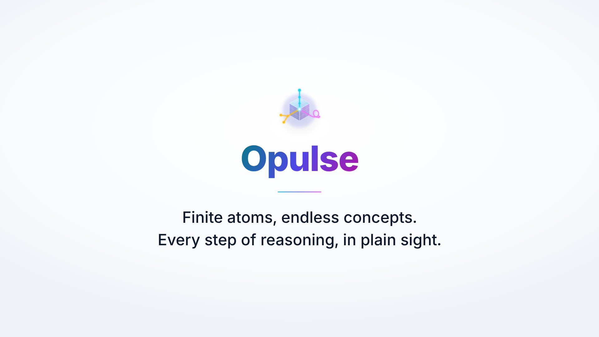
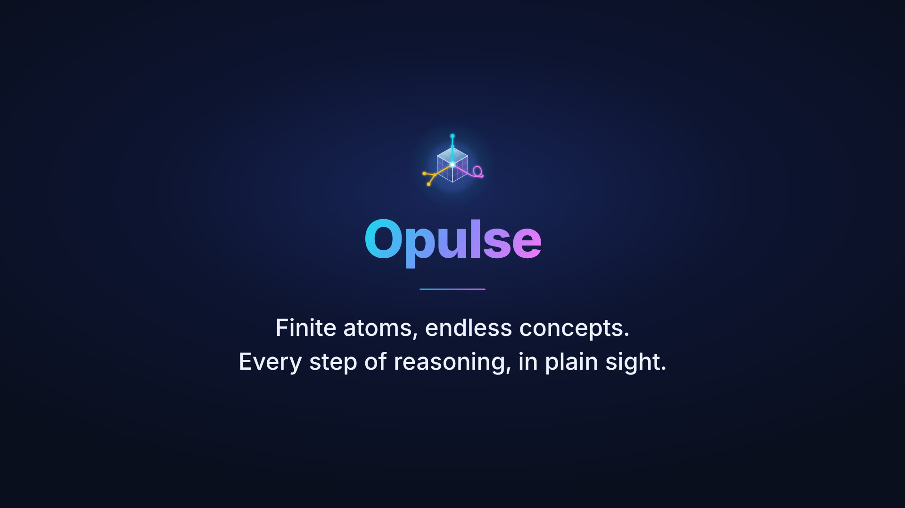

---
hide:
  - navigation
  - toc
---

<link rel="stylesheet" href="assets/css/atoms2-roads.css">
<link rel="stylesheet" href="assets/css/atoms2-first-tower.css">

# Invent the pieces; then build with them.

In a finite world, invent objects, operations, ways to combine them, and observations. Reuse them in later layers with a checkable record. Worlds can also open laws and bridges.

[See how it grows](learn/){ .md-button .md-button--primary } [Try a challenge](play/challenge/){ .md-button }

[Browse worlds](worlds/) | [Research uses](research/)

<section class="roads-card" data-roads-home aria-label="Is the road route optimal?">

A route across 12 junctions, built from five core-run definitions

<h2>A valid route can still be wrong.</h2>

See the core run artifact for the check scope

The <a href="assets/data/atoms2/roads_core.json">roads core run artifact</a> records the bounded check scope. The larger Metro run is a separate call outside that checked scope. The browser separately checks the public Metro map.

The optimal-route observation asks whether the A-to-L route through A, D, F, H, K and L is cheapest.

Loading road steps...

Answer: false. This route is valid, but a cheaper route exists.

<button class="a2-btn" type="button" data-roads-next>Next recorded step</button> <button class="a2-btn" type="button" data-roads-play>Play recorded steps</button> <a href="learn/">See all dependencies</a>

Five definitions, shown in order. Each recorded core run is separate from its definition evidence; badges require recorded checked-input scopes.

<ol class="roads-dependency-list" data-roads-home-deps aria-label="Core-run road definitions"></ol>

Compare two routes step by step.

<strong>Start A / destination L</strong>

Asked route: <code>A,D,F,H,K,L</code>. Cost: 12.

Cheapest route: <code>A,D,G,I,K,L</code>. Cost: 11.

Core and browser comparison loading.

<strong>Why the answer changes:</strong> both routes reach L, but the dashed route costs one less.

Scroll the map sideways to reach L.

<a href="play/challenge/">Try this step: find the worst two-road closure</a>

</section>

<section class="first-tower" aria-label="Integer tower, run on the core">
<h2>A second, independent tower: integer and fractions</h2>

This tower shows fraction multiplication and a failed construction. A fraction with a zero denominator fails as invalid. Natural numbers feed repeat, then multiplication and fraction multiplication. Fractions also feed fraction multiplication. The seen-value observation reads the result through the granted value probe. It does not call fraction multiplication. Outcomes come from core runs at build time. <a href="worlds/integer/">Explore the integer world</a>.

<ol class="first-tower-fallback" data-first-tower-fallback aria-label="Integer tower summary without JavaScript">
<li>L1 Core summary: Natural numbers keep nonnegative integers. Bounded (61 cases)</li>
<li>L2 Core summary: Repeat applies a supplied operation to a seed the requested number of times. Uses Nat. Bounded (50 cases)</li>
<li>L3 Core summary: Multiplication counts ticks, adds the left magnitude once per tick, and negates the result when input signs differ. Uses Nat, @repeat. Bounded (169 cases)</li>
<li>L1 Core summary: Fractions reject a zero denominator and reduce numerator and denominator with a consistent sign. Bounded (169 cases)</li>
<li>L4 Core summary: Fraction multiplication multiplies the numerators and denominators, then constructs a reduced fraction. Uses Frac, mul. Bounded (100 cases)</li>
<li>L1 Printed from the core definition (re-parses: yes): <code>obs ?seen_value{value} = ?value{value} L1</code>. Bounded (21 cases)</li>
<li><code>Frac&lt;1, 0&gt;</code> Executable (core run artifact) returns <code>Bottom(invalid)</code> through the core.</li>
</ol>

Each row has bounded evidence from the <a href="assets/data/atoms2/first_tower.json">versioned run artifact</a>. The prose summaries describe these core definitions, not the longer twelve-card <a href="worlds/integer/">story design text</a>. Only the printed row is pasteable source.

</section>

